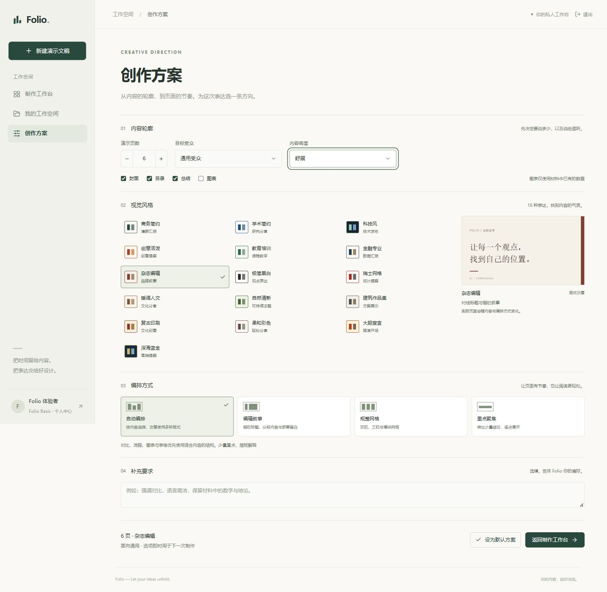

# Folio

**Let your ideas unfold.** 从一段想法、一份文档开始，制作清晰、耐看、可编辑的演示文稿。

Folio 是原 PPTMaker 项目的新品牌。公开首页介绍功能、风格、流程与使用场景，注册或登录后进入制作工作台。界面采用纸白、墨绿与浅灰绿，公开页与所有业务页共用设计语言。

## 现在可以做什么

- 注册、登录、退出与修改密码；每个账号拥有独立的演示、附件、资料、用量和额度。
- 输入文字，点击选择或将 PDF、DOCX、Markdown、TXT 拖入工作台页面；单文件最大 10 MiB。
- 在“创作方案”选择 1–50 页、受众、16 种演示风格、4 种编排、3 档内容密度及结构选项；可补充制作要求。
- 自动整理材料、规划大纲、并行制作、检查排版、导出可编辑 `.pptx`；逐页查看预览、正文与演讲备注，点击按钮下载；完成后不会自动下载。
- 在工作空间搜索、排序、收藏、重命名、添加标签、归档与恢复历史演示；打开已完成演示直接预览和下载，不重新调用模型。
- 管理服务端保存的个人资料、默认创作方案；查看管理员配置的会员权益、真实 Token 用量、缓存命中和月度输出预算。

账号与会话存入后端数据库，密码以随机盐 scrypt 散列保存，会话使用 HttpOnly Cookie。演示、图片、PPTX 和实时生成均校验用户归属。前端不在 localStorage 保存账号、用量或登录令牌。注册默认 Folio Basic，会员按用户配置；未接入邮件认证、密码找回、在线支付和服务商余额查询。按本次要求不迁移原共享账号数据，新用户从独立空工作空间开始。

## 应用页面

以下为本地运行的真实页面截图，使用独立验收账号与阅读活动示例。

**公开首页**：介绍功能、使用场景与流程，登录 / 注册融入同一页面。


**制作工作台**：输入内容、拖入参考文档，开始演示制作。


**创作方案**：16 种视觉风格、编排方式与内容密度，紧凑列表配合选中样式预览；共享纸白 / 浅绿下拉菜单与页数加减控件，支持键盘操作。



<details>
<summary>查看统一控件的展开状态</summary>


</details>

**演示预览**：按页查看，完成后点击“下载 PowerPoint”。


<details>
<summary>查看手机创作方案</summary>


</details>

模板研究与内置实现见 [模板风格参考](docs/TEMPLATE_REFERENCES.md)。当前使用可编辑的本地版式，未接入第三方 PPTX 模板导入或素材图库。

## 本地启动

要求：Python 3.10+、Node.js 18+。以下命令从仓库根目录开始，在两个终端中运行。

后端：

```powershell
cd backend
python -m pip install -e ".[dev]"
Copy-Item .env.example .env  # 仅首次使用；已有配置不要覆盖
# 编辑 .env 中的模型服务与 API Key
python -m uvicorn app.main:app --host 127.0.0.1 --port 8000
```

前端：

```powershell
cd frontend
npm ci
npm run dev -- --host 127.0.0.1
```

打开 http://127.0.0.1:5173 。FastAPI 文档在 http://127.0.0.1:8000/docs ，健康检查为 `/health`。后端根路径返回服务信息，**不会直接提供前端网页**。Vite 代理 `/api`、`/ws`、`/storage` 到后端；可用 `VITE_BACKEND_HOST`、`VITE_BACKEND_WS_HOST` 修改开发代理地址。

## 配置

完整示例见 [backend/.env.example](backend/.env.example)。`.env` 按后端包的绝对位置读取，修改后重启后端。

| 配置 | 含义 |
|---|---|
| `LLM_PROVIDER` | `openai` 或 `anthropic`；兼容接口使用 `openai` |
| `OPENAI_API_KEY` / `OPENAI_BASE_URL` / `OPENAI_MODEL` | 模型凭据、地址、名称；不要提交真实密钥 |
| `OPENAI_MAX_TOKENS` | 单次输出硬上限；各步骤还会应用更小的预算 |
| `PPT_CONCURRENCY` | 逐页并行度，默认 3，上限 8 |
| `PPT_MAX_REVIEW_ROUNDS` | 初次检查后的自动调整次数，默认 2，范围 1–4 |
| `PPT_REVIEW_MODE` | 默认 `local`；`vision` 需要支持图片的模型 |
| `DEEPSEEK_REASONING_EFFORT` | 普通改写默认 `none`，可按角色覆盖 |
| `LLM_JSON_MODE` | `auto` / `on` / `off`，兼容网关需确认支持 |
| `FOLIO_SESSION_DAYS` | 会话有效期，默认 7 天，1–30 天 |
| `FOLIO_COOKIE_SECURE` | 本地 HTTP 为 false，生产 HTTPS 必须 true |
| `FOLIO_ALLOWED_ORIGINS` | 明确的前端 Origin 白名单，生产填写真实 HTTPS 域名 |
| `FOLIO_MONTHLY_OUTPUT_LIMIT` | 每用户默认 UTC 月度输出预算，0 不限，用户级预算优先 |
| `FOLIO_DB` | 可选 SQLite 路径；未设置时沿用 `PPTMAKER_DB` 或 `storage/pptmaker.sqlite3` |
| `STORAGE_PATH` | PPTX、PNG 存储目录，默认后端工作目录下的 `storage` |

额度由服务端按账号管理，不能代表供应商余额。并行调用原子预留预算，返回后按实际用量结算；不足时不会发送模型请求。管理员可从仓库根目录为已注册用户配置权益与预算：

```powershell
python scripts/manage_user.py --email author@example.com --tier plus --monthly-output-limit 100000
# 可选 --expires-at 2027-01-01T00:00:00+00:00；none 清除到期时间
```

此命令只更新指定用户，网页资料 API 无权修改会员或额度。生产数据库与文件目录必须是服务端持久磁盘，不能放在浏览器或临时容器层。

## API 概览

生成操作走双向 WebSocket `ws://127.0.0.1:8000/ws/{project_id}`，REST 负责创建、历史和账号查询。完整字段与消息见 [API 文档](docs/API.md)。

| 方法 | 路径 | 用途 |
|---|---|---|
| POST | `/api/v1/auth/register`、`/login` | 注册 / 登录，返回当前账号和 CSRF token |
| GET | `/api/v1/auth/session` | 从服务器恢复登录会话 |
| POST | `/api/v1/auth/logout`、`/password` | 退出 / 修改密码并撤销旧会话 |
| POST | `/api/v1/projects` | 创建项目，返回完整初始快照 |
| GET | `/api/v1/projects` | 搜索、筛选、排序、分页的历史摘要 |
| GET | `/api/v1/design/catalog` | 16 种风格与编排 / 密度选项 |
| GET | `/api/v1/projects/{id}` | 恢复完整项目及有效下载链接 |
| PATCH | `/api/v1/projects/{id}` | 标题、收藏、归档、标签 |
| GET | `/api/v1/workspace` | 历史数量、完成、收藏、页面与存储统计 |
| POST | `/api/v1/upload/parse` | multipart 文档文本提取 |
| GET | `/api/v1/account` | 当前用户的服务端资料、会员、用量与连接概况 |
| PATCH | `/api/v1/account/profile` | 修改个人资料和默认偏好 |
| GET | `/api/v1/account/usage` | 持久化月度用量与额度 |
| GET | `/api/v1/account/membership` | 当前会员状态与权益 |
| GET | `/api/v1/llm/usage?project_id={id}` | 当前进程的调用诊断 |
| GET | `/storage/{filename}` | 下载 PPTX 或读取 PNG 预览 |

不存在 `/projects/{id}/generate`、`/parse`、`/plan` 等生成 REST 接口；网页只发送 `run_workflow` 让后端选择剩余步骤。“继续调整问题页”发送 `generate_parallel`；`parse_input`、`plan_outline`、`render_pptx` 等低层命令仍保留。

## 结构与生成原理

```text
frontend/src/
  App.tsx                         会话恢复、路由保护与交互展示
  components/layout/PublicHome    公开首页、登录、注册
  components/layout/StudioShell   全页共用侧栏、品牌、导航
  components/layout/*Page         设置、工作空间、账号、演示预览
  stores/projectStore.ts          草稿、项目、WebSocket 命令
backend/app/
  api/routes.py                   创建、列表、上传、诊断
  api/workspace.py                按用户隔离的历史、元数据、账号
  api/auth.py                     Cookie 登录、CSRF、归属校验
  api/files.py                    私有预览与下载
  api/websocket.py                队列与生成流程
  agent/nodes/                    内容规划与受控检查
  tools/slide_scene.py             PNG 与 PPTX 共用排版
  tools/pptx_generator.py          可编辑原生对象导出
  llm/                            SDK 复用、缓存、真实用量
  storage/                        SQLite 项目、账号、用量账本
```

模型负责内容，代码负责排版。紧凑 JSON 保留校验能力；封面、目录与结束页复用大纲，Designer 默认采用本地模板，Critic 默认检查几何与可读性。预览和导出共享英寸坐标、文本换行、字号与配色。浏览器只挂载当前页的完整预览。

检查发现问题后先自动调整布局，必要时调整内容；达到调整上限仍有建议，或调整出错时，保留最佳可用页面并导出，不让检查建议导致整份演示失败。制作页可查看建议、下载当前版本或继续调整问题页；重试跳过已完成且通过的页面。视觉模型异常会明确提示回退本地排版检查，不把回退当成视觉复核通过。实际写作、绘制或导出错误仍如实显示，并保留已完成页面。

前端保留表单、导航、草稿和显示格式；业务校验、文档组装、步骤选择、生成状态、排版、文件可用性、权限、会员和用量由后端处理。添加文档不改写输入要求，前端只提交附件 ID；没有真实预览时明确展示正文摘录，不另绘一套幻灯片。生成状态、并行统计和预览时间直接使用服务端结果。

项目、个人资料与用量写入 SQLite；进程重启后可以恢复历史。开始 / 继续、调整和导出任务由后端持有，页面关闭或刷新后继续，重连恢复真实快照与下载链接；同一项目重复提交复用现有任务。当前仅支持单 worker；服务重启仍会中断任务，标记可重试并保留材料与页面，用户点击后才继续。结果缓存是进程内缓存，重启会失效；月度用量不会失效。

## 验证与文档

```powershell
# backend
python -m pytest -q -p no:cacheprovider
# frontend
npm test
npm run build
```

不调用模型的 PPT 样张：从仓库根目录运行 `python scripts/preview_styles.py`，输出到 `storage/design_samples/`。真实生成会使用已配置的模型服务并产生调用费用。

- [当前需求与规格](SPEC.md)
- [设计系统与新页面约定](docs/DESIGN_SYSTEM.md)
- [API 与 WebSocket 协议](docs/API.md)
- [优化研究、缓存与费用实测](docs/OPTIMIZATION.md)
- [部署与备份](DEPLOY.md)
- [测试与验收](TESTING.md)

目前不包含在线支付、邮件验证 / 密码找回、扫描 PDF OCR、外部 PPTX 母版导入和浏览器内完整幻灯片编辑。PNG 是轻量预览，PowerPoint 字体替换、原生图表轴线与表格细节可能产生差异。支持多用户，生成任务仍需单个后端 worker；生产使用 HTTPS、明确 Origin 和持久存储，详见部署说明。
