# Folio

**Let your ideas unfold.** 从一段想法、一份文档开始，制作清晰、耐看、可编辑的演示文稿。

Folio 是原 PPTMaker 项目的新品牌。公开首页介绍功能、风格、流程与使用场景，注册或登录后进入制作工作台。界面采用纸白、墨绿与浅灰绿，公开页与所有业务页共用设计语言。

## 现在可以做什么

- 注册、登录、退出与修改密码；每个账号拥有独立的演示、附件、资料、用量和额度。
- 输入文字，选择、拖入或 Ctrl+V 粘贴 PDF、DOCX、PPTX、Markdown、TXT、CSV 与图片到创作页；单文件最大 10 MiB，截图可提取中英文文字。
- 在“创作方案”按会员权益选择页数（系统上限 50）、受众、16 种演示风格、4 种编排、3 档内容密度及结构选项；可开启或关闭自动配图，补充制作要求。
- 自动整理材料、规划大纲、并行制作、检查排版、导出可编辑 `.pptx`；逐页查看预览、正文与演讲备注，点击按钮下载；完成后不会自动下载。
- 在工作空间搜索、排序、收藏、重命名、添加标签、归档与恢复历史演示；打开已完成演示直接预览和下载，不重新调用模型。
- 管理服务端保存的个人资料、默认创作方案；查看管理员配置的会员权益、真实 Token 用量、缓存命中和月度输出预算。

账号与会话存入后端数据库，密码以随机盐 scrypt 散列保存，会话使用 HttpOnly Cookie。演示、图片、PPTX 和实时生成均校验用户归属。前端不在 localStorage 保存账号、用量或登录令牌。注册默认普通会员；管理员可分配 Plus / Pro / Studio。未接入邮件认证、自助密码找回和在线支付；管理页支持用户密码重置及 DeepSeek 官方余额查询。按本次要求不迁移原共享账号数据，新用户从独立空工作空间开始。

## 应用页面

以下为本地运行的真实页面截图，使用独立验收账号与阅读活动示例。

**公开首页**：介绍功能、使用场景与流程，登录 / 注册融入同一页面。

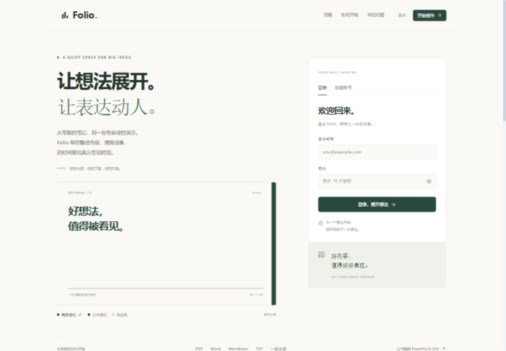

**制作工作台**：输入内容、拖入参考文档，开始演示制作。

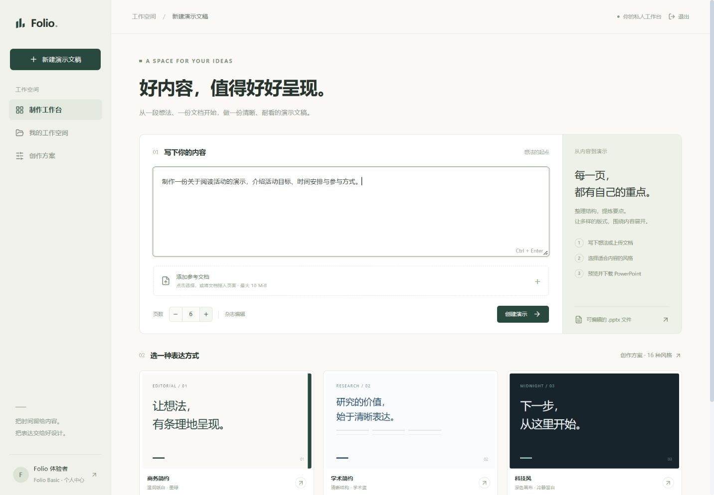

**创作方案**：默认自动分析主题，也可手动选择16种视觉风格、编排方式与内容密度，紧凑列表配合选中样式预览；共享纸白 / 浅绿下拉菜单与页数加减控件，支持键盘操作。

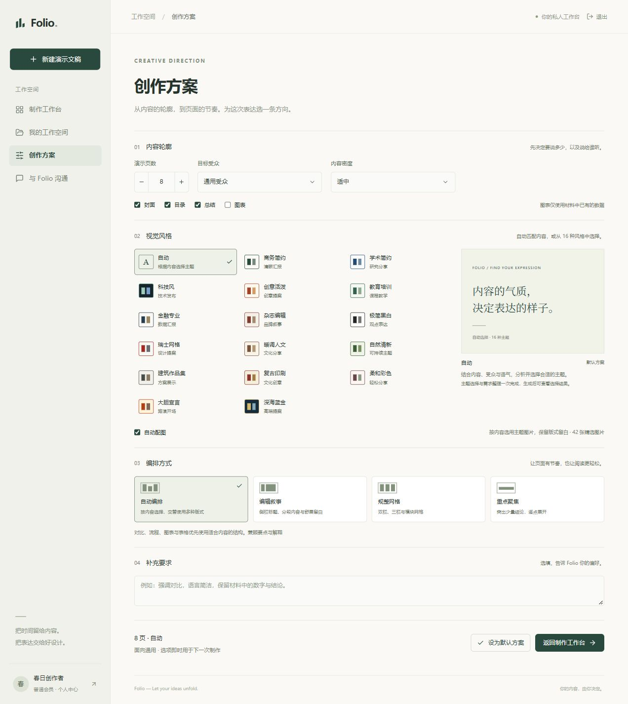

<details>
<summary>查看统一控件的展开状态</summary>

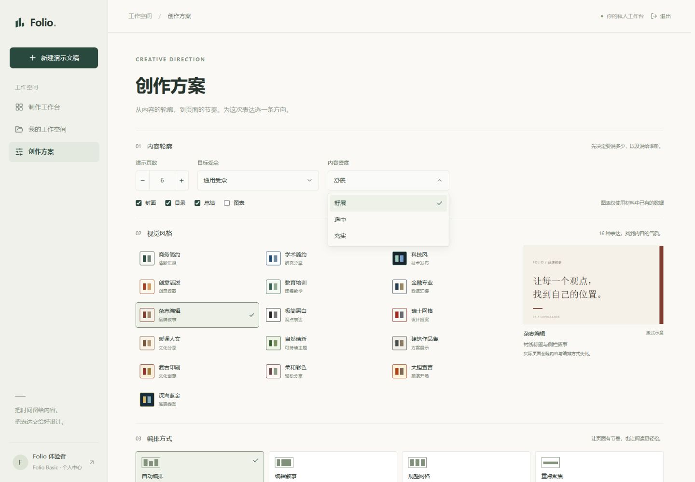

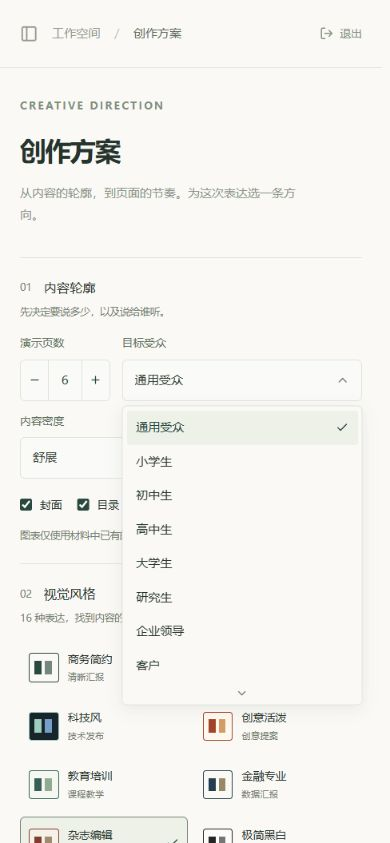

</details>

**自动配图**：内置 42 张精选主题照片，AI 依据每页内容选图，图片使用独立区域、保持比例裁剪。密集内容、图表、表格与对比页优先保留文字和数据；来源与许可随页面备注导出。[查看图片清单](docs/IMAGE_SOURCES.md)。


**演示预览**：按页查看，完成后点击“下载 PowerPoint”。

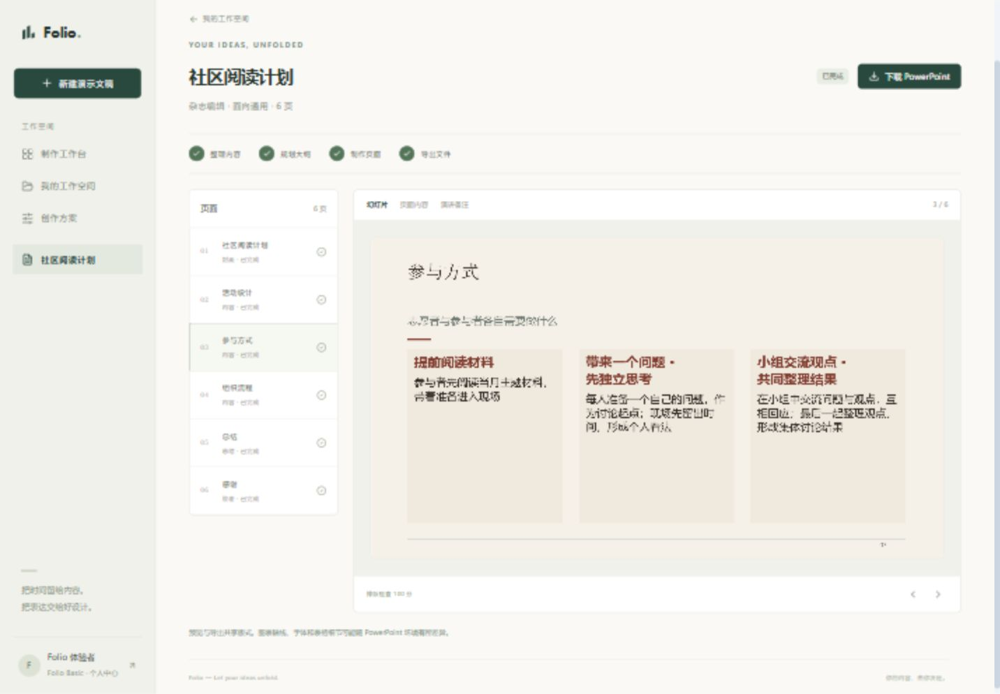

<details>
<summary>查看手机创作方案</summary>

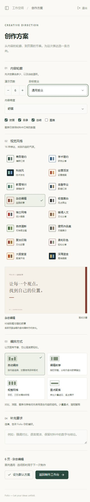

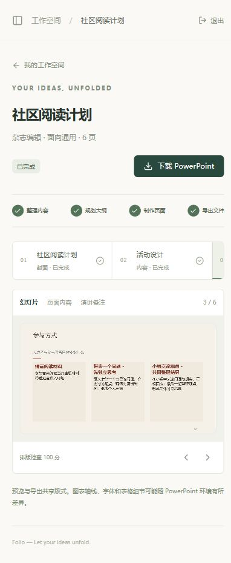

</details>

模板研究与内置实现见 [模板风格参考](docs/TEMPLATE_REFERENCES.md)。当前使用可编辑的本地版式，未接入第三方 PPTX 模板导入或素材图库。

**管理中心**：独立管理登录与主页，侧栏、表单和按钮沿用 Folio 现有设计。

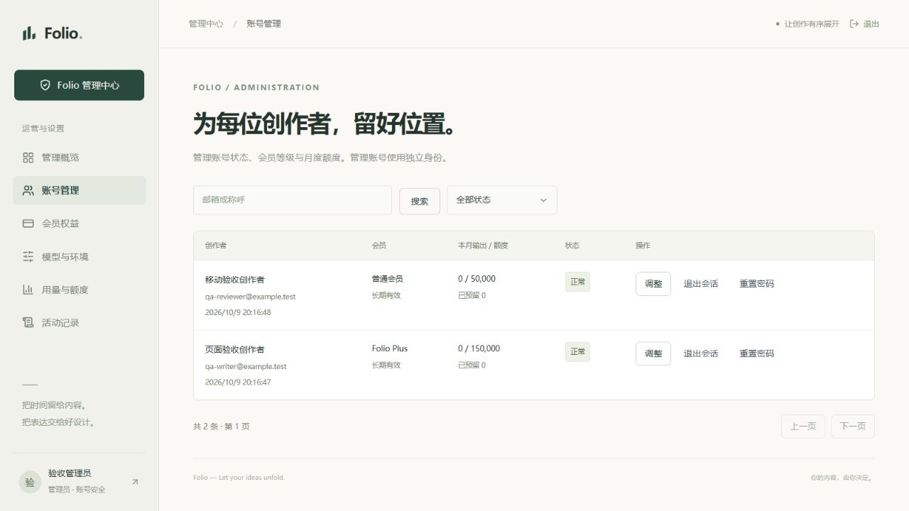

<details>
<summary>查看管理登录、概览与手机权益设置</summary>

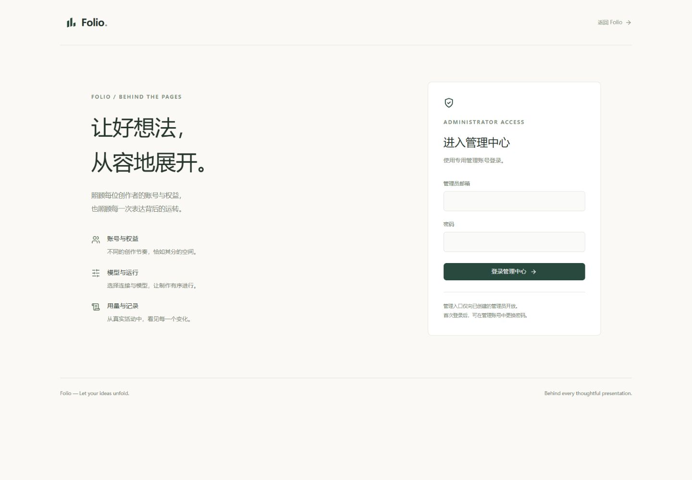

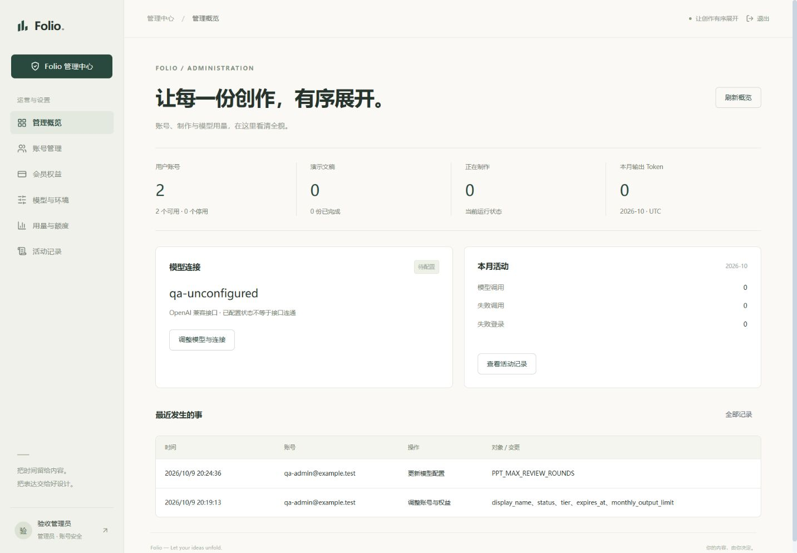

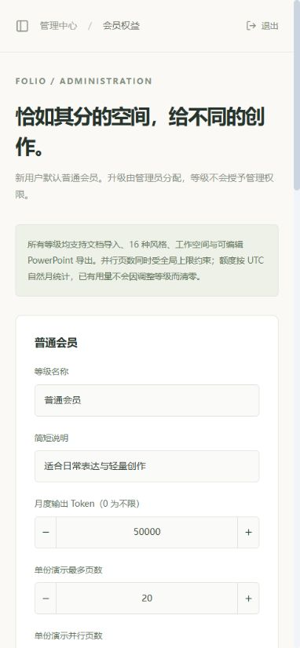

</details>

## 管理员与会员

已部署入口：[Folio](https://lightsmile.ink) · [独立管理中心](https://lightsmile.ink/#/admin/login)。服务器维护与此次部署验收见 [运行记录](docs/OPERATIONS.md)。

管理员从 `/#/admin/login` 登录，使用新建的专用身份，不提升已有用户。开发时从后端工作目录初始化：

```powershell
cd backend
python ../scripts/create_admin.py --env-file .env --email admin@lightsmile.ink --credentials-file ../storage/admin-bootstrap.txt
```

随机初始密码仅写入新建文件；已有邮箱 / 凭据文件会拒绝覆盖。登录后在“管理账号”修改密码，再删除初始凭据。生产使用安装包提供的 `folio-create-admin`，命令与权限见 [DEPLOY.md](DEPLOY.md)。

管理中心包含概览、账号管理、会员权益、模型与环境、用量与额度、活动记录。支持账号搜索 / 停用 / 启用、撤销会话 / 密码重置、等级与到期 / 独立额度、方案编辑、允许的 .env 运行参数修改、模型目录与真实余额查询，以及登录 IP / 设备、使用、生成、调用与管理记录。

| 默认会员 | 月度输出 Token | 最多页数 | 单份并行页数 |
|---|---:|---:|---:|
| 普通会员 | 50,000 | 20 | 1 |
| Plus | 150,000 | 35 | 2 |
| Pro | 500,000 | 50 | 3 |
| Studio | 2,000,000 | 50 | 6 |

新用户默认普通会员。等级由管理员切换，到期恢复普通权益；独立额度优先，0 为不限。实际并行不超过全局上限，后台执行全部限制。所有等级支持现有文档、风格、工作空间和导出，会员不赋予管理权限，无支付和自动续费。

API Key 只写不读，配置修订冲突或正在制作时拒绝保存。供应商余额目前仅支持 [DeepSeek 官方接口](https://api-docs.deepseek.com/api/get-user-balance/)，其他接口明确显示不支持。记录不存提示词、模型正文、密码或密钥；启用前事件不补造。管理会话不能访问用户私有文件。接口详见 [管理 API](docs/ADMIN_API.md)。

## 本地启动

要求：Python 3.10+、Node.js 18+。以下命令从仓库根目录开始，在两个终端中运行。

后端：

```powershell
cd backend
python -m pip install -e ".[dev]"
Copy-Item .env.example .env  # 仅首次使用；已有配置不要覆盖
# 编辑 .env 中的模型服务与 API Key
python -m uvicorn app.main:app --host 127.0.0.1 --port 8000
```

前端：

```powershell
cd frontend
npm ci
npm run dev -- --host 127.0.0.1
```

打开 http://127.0.0.1:5173 。FastAPI 文档在 http://127.0.0.1:8000/docs ，健康检查为 `/health`。后端根路径返回服务信息，**不会直接提供前端网页**。Vite 代理 `/api`、`/ws`、`/storage` 到后端；可用 `VITE_BACKEND_HOST`、`VITE_BACKEND_WS_HOST` 修改开发代理地址。

## 配置

开发配置见 [backend/.env.example](backend/.env.example)，从后端包位置读取；发布包使用 `folio-server --env-file /etc/folio/runtime/folio.env` 加载外部配置。管理页允许的运行项保存后立即应用；离线配置修改后重启后端。

| 配置 | 含义 |
|---|---|
| `LLM_PROVIDER` | `openai` 或 `anthropic`；兼容接口使用 `openai` |
| `OPENAI_API_KEY` / `OPENAI_BASE_URL` / `OPENAI_MODEL` | 模型凭据、地址、名称；不要提交真实密钥 |
| `OPENAI_MAX_TOKENS` | 单次输出硬上限；各步骤还会应用更小的预算 |
| `PPT_CONCURRENCY` | 逐页并行度，默认 3，上限 8 |
| `PPT_MAX_REVIEW_ROUNDS` | 初次检查后的自动调整次数，默认 2，范围 1–4 |
| `PPT_REVIEW_MODE` | 默认 `local`；`vision` 需要支持图片的模型 |
| `DEEPSEEK_REASONING_EFFORT` | 普通改写默认 `none`，可按角色覆盖 |
| `LLM_JSON_MODE` | `auto` / `on` / `off`，兼容网关需确认支持 |
| `FOLIO_SESSION_DAYS` | 会话有效期，默认 7 天，1–30 天 |
| `FOLIO_COOKIE_SECURE` | 本地 HTTP 为 false，生产 HTTPS 必须 true |
| `FOLIO_ALLOWED_ORIGINS` | 明确的前端 Origin 白名单，生产填写真实 HTTPS 域名 |
| `FOLIO_REGISTRATION_ENABLED` | 是否开放新用户注册，默认 true |
| `FOLIO_MONTHLY_OUTPUT_LIMIT` | 仅无用户身份的离线兼容调用预算；已登录用户使用会员方案 / 账号独立额度 |
| `FOLIO_DB` | 可选 SQLite 路径；未设置时沿用 `PPTMAKER_DB` 或 `storage/pptmaker.sqlite3` |
| `STORAGE_PATH` | PPTX、PNG 存储目录，默认后端工作目录下的 `storage` |

额度由服务端按账号管理，不能代表供应商余额。并行调用原子预留预算，返回后按实际用量结算；不足时不会发送模型请求。管理员也可从后端工作目录为已注册用户配置权益与预算：

```powershell
cd backend
python ../scripts/manage_user.py --env-file .env --email author@example.com --tier plus --monthly-output-limit 100000
# 可选 --expires-at 2027-01-01T00:00:00+00:00；none 清除到期时间
```

此命令只更新指定用户，网页资料 API 无权修改会员或额度。生产数据库与文件目录必须是服务端持久磁盘，不能放在浏览器或临时容器层。

## API 概览

生成操作走双向 WebSocket `ws://127.0.0.1:8000/ws/{project_id}`，REST 负责创建、历史和账号查询。完整字段与消息见 [API 文档](docs/API.md)。

| 方法 | 路径 | 用途 |
|---|---|---|
| POST | `/api/v1/auth/register`、`/login` | 注册 / 登录，返回当前账号和 CSRF token |
| GET | `/api/v1/auth/session` | 从服务器恢复登录会话 |
| POST | `/api/v1/auth/logout`、`/password` | 退出 / 修改密码并撤销旧会话 |
| POST | `/api/v1/projects` | 创建项目，返回完整初始快照 |
| GET | `/api/v1/projects` | 搜索、筛选、排序、分页的历史摘要 |
| GET | `/api/v1/design/catalog` | 16 种风格与编排 / 密度选项 |
| GET | `/api/v1/projects/{id}` | 恢复完整项目及有效下载链接 |
| PATCH | `/api/v1/projects/{id}` | 标题、收藏、归档、标签 |
| GET | `/api/v1/workspace` | 历史数量、完成、收藏、页面与存储统计 |
| POST | `/api/v1/upload/parse` | multipart 文档文本提取 |
| GET | `/api/v1/account` | 当前用户的服务端资料、会员、用量与连接概况 |
| PATCH | `/api/v1/account/profile` | 修改个人资料和默认偏好 |
| GET | `/api/v1/account/usage` | 持久化月度用量与额度 |
| GET | `/api/v1/account/membership` | 当前会员状态与权益 |
| GET | `/api/v1/llm/usage?project_id={id}` | 当前进程的调用诊断 |
| GET | `/storage/{filename}` | 下载 PPTX 或读取 PNG 预览 |

不存在 `/projects/{id}/generate`、`/parse`、`/plan` 等生成 REST 接口；网页只发送 `run_workflow` 让后端选择剩余步骤。“继续调整问题页”发送 `generate_parallel`；`parse_input`、`plan_outline`、`render_pptx` 等低层命令仍保留。

## 结构与生成原理

```text
frontend/src/
  App.tsx                         会话恢复、路由保护与交互展示
  components/layout/PublicHome    公开首页、登录、注册
  components/layout/StudioShell   全页共用侧栏、品牌、导航
  components/layout/*Page         设置、工作空间、账号、演示预览
  stores/projectStore.ts          草稿、项目、WebSocket 命令
backend/app/
  api/routes.py                   创建、列表、上传、诊断
  api/workspace.py                按用户隔离的历史、元数据、账号
  api/auth.py                     Cookie 登录、CSRF、归属校验
  api/files.py                    私有预览与下载
  api/websocket.py                队列与生成流程
  agent/nodes/                    内容规划与受控检查
  tools/slide_scene.py             PNG 与 PPTX 共用排版
  tools/pptx_generator.py          可编辑原生对象导出
  llm/                            SDK 复用、缓存、真实用量
  storage/                        SQLite 项目、账号、用量账本
```

模型负责内容，代码负责排版。紧凑 JSON 保留校验能力；封面、目录与结束页复用大纲，Designer 默认采用本地模板，Critic 默认检查几何与可读性。预览和导出共享英寸坐标、文本换行、字号与配色。浏览器只挂载当前页的完整预览。

检查发现问题后先自动调整布局，必要时调整内容；达到调整上限仍有建议，或调整出错时，保留最佳可用页面并导出，不让检查建议导致整份演示失败。制作页可查看建议、下载当前版本或继续调整问题页；重试跳过已完成且通过的页面。视觉模型异常会明确提示回退本地排版检查，不把回退当成视觉复核通过。实际写作、绘制或导出错误仍如实显示，并保留已完成页面。

前端保留表单、导航、草稿和显示格式；业务校验、文档组装、步骤选择、生成状态、排版、文件可用性、权限、会员和用量由后端处理。添加文档不改写输入要求，前端只提交附件 ID；没有真实预览时明确展示正文摘录，不另绘一套幻灯片。生成状态、并行统计和预览时间直接使用服务端结果。

项目、个人资料与用量写入 SQLite；进程重启后可以恢复历史。开始 / 继续、调整和导出任务由后端持有，页面关闭或刷新后继续，重连恢复真实快照与下载链接；同一项目重复提交复用现有任务。当前仅支持单 worker；服务重启仍会中断任务，标记可重试并保留材料与页面，用户点击后才继续。结果缓存是进程内缓存，重启会失效；月度用量不会失效。

## 构建与部署

在仓库根目录构建前端静态资源、后端 wheel 和部署模板，生成 ZIP / tar.gz 及 SHA256 校验文件：

```powershell
python scripts/build.py --domain lightsmile.ink
# Windows: scripts\build.bat；Linux/macOS: bash scripts/build.sh
```

本地 `deploy/lightsmile.ink.pem` 和 `.key` 会一起打包到独立 `tls/` 目录，配置使用 `https://lightsmile.ink`。**包中包含私钥，只供自己的服务器部署；分享包时加 `--without-certificates`。**真实 `.env`、数据库和上传资料不进入包。

生产服务器无需源码仓库或 Node，安装 wheel 后运行 `folio-server`，仍需 Python 3.10+。包附 Nginx HTTPS / WS 配置、systemd 单 worker 服务和安装脚本。服务器初始化、证书安装、配置、管理员初始化、升级、回滚与备份步骤见 [部署指南](DEPLOY.md)。离线会员管理使用 `folio-manage-user --env-file /etc/folio/runtime/folio.env`。

## 验证与文档

```powershell
# backend
python -m pytest -q -p no:cacheprovider
# frontend
npm test
npm run build
```

不调用模型的 PPT 样张：从仓库根目录运行 `python scripts/preview_styles.py`，输出到 `storage/design_samples/`。真实生成会使用已配置的模型服务并产生调用费用。

- [当前需求与规格](SPEC.md)
- [设计系统与新页面约定](docs/DESIGN_SYSTEM.md)
- [API 与 WebSocket 协议](docs/API.md)
- [优化研究、缓存与费用实测](docs/OPTIMIZATION.md)
- [部署与备份](DEPLOY.md)
- [测试与验收](TESTING.md)

目前不包含在线支付、邮件验证 / 密码找回、扫描 PDF OCR、外部 PPTX 母版导入和浏览器内完整幻灯片编辑。PNG 是轻量预览，PowerPoint 字体替换、原生图表轴线与表格细节可能产生差异。支持多用户，生成任务仍需单个后端 worker；生产使用 HTTPS、明确 Origin 和持久存储，详见部署说明。


## 自动主题与问题沟通

默认“自动”会结合内容、受众和语气选择实际主题，和需求整理共用一次模型调用。生成后可查看主题名称与选择依据；仍可手动选定16种风格。

用户侧栏“与 Folio 沟通”支持文字、图片、拖入或粘贴截图。管理员在“用户沟通”查看未读、历史图文，回复并跟进处理状态；在线时双方会收到站内消息提示。每条最多4000字、3个附件；PNG / JPEG / WebP 图片每张5 MiB，其他文件每个10 MiB。支持选择、页面内拖放与 Ctrl+V 粘贴，图片预览、文件点击下载。历史与已读位置保留，没有邮件或离线推送。

管理员还可在“活动记录 → 生成记录 → 查看演示”预览用户生成的页面、查看正文与备注，并点击下载已完成的 PPTX。管理访问单独校验和审计，普通用户的文件仍互相隔离。

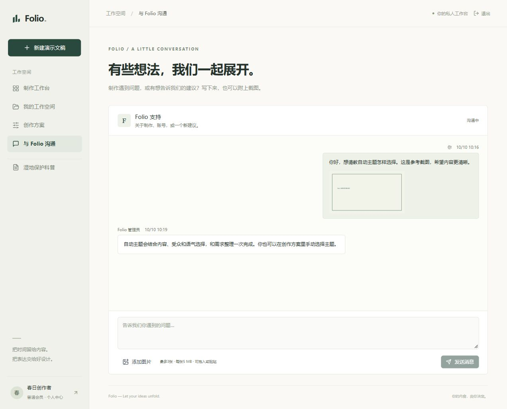

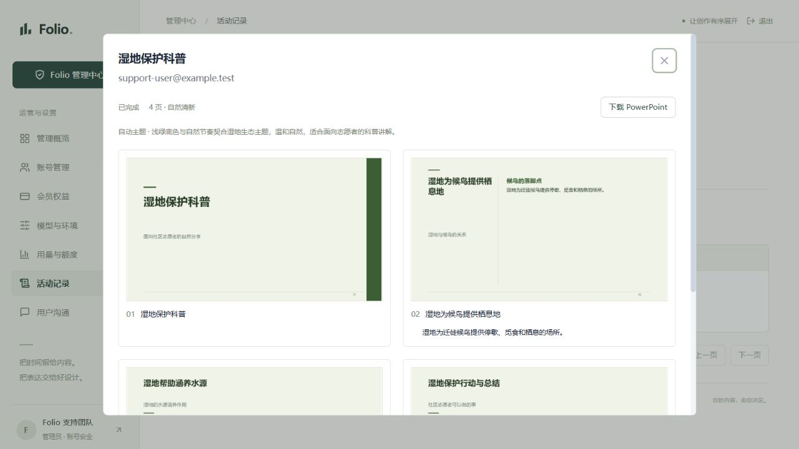


<details>
<summary>查看手机图文沟通</summary>

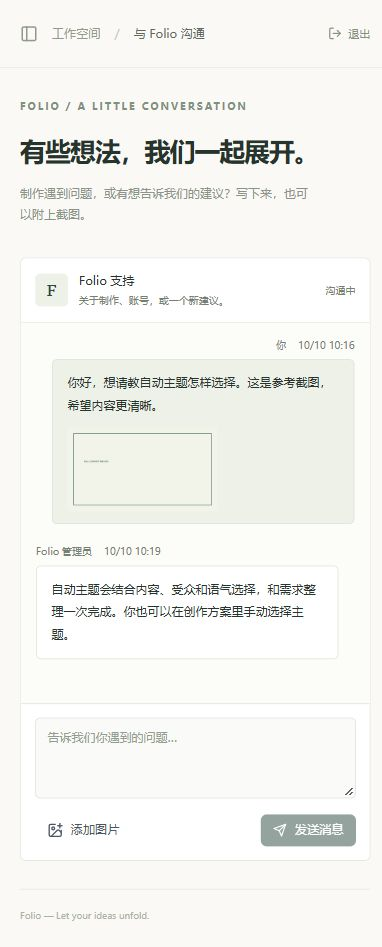

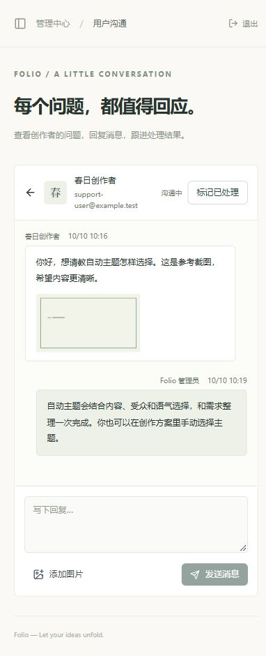

</details>


创作页粘贴截图、沟通页的图文与文档附件（隔离测试账号，真实页面）：

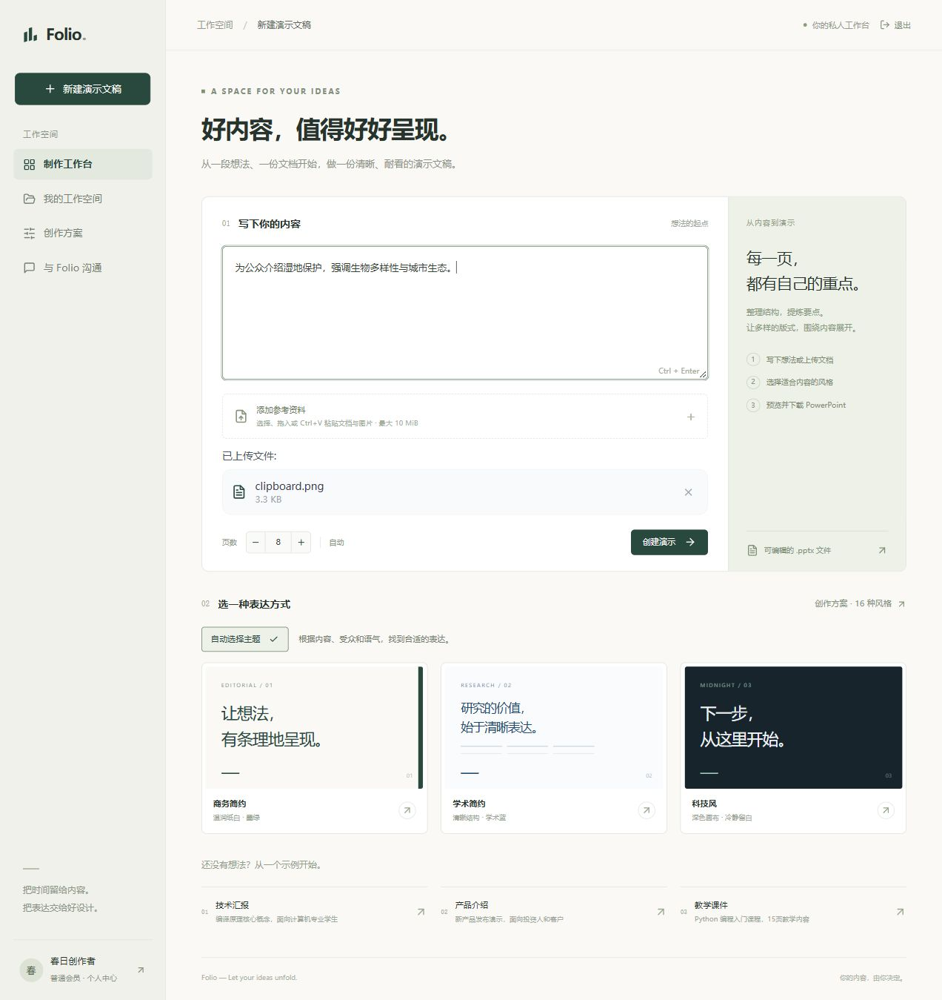

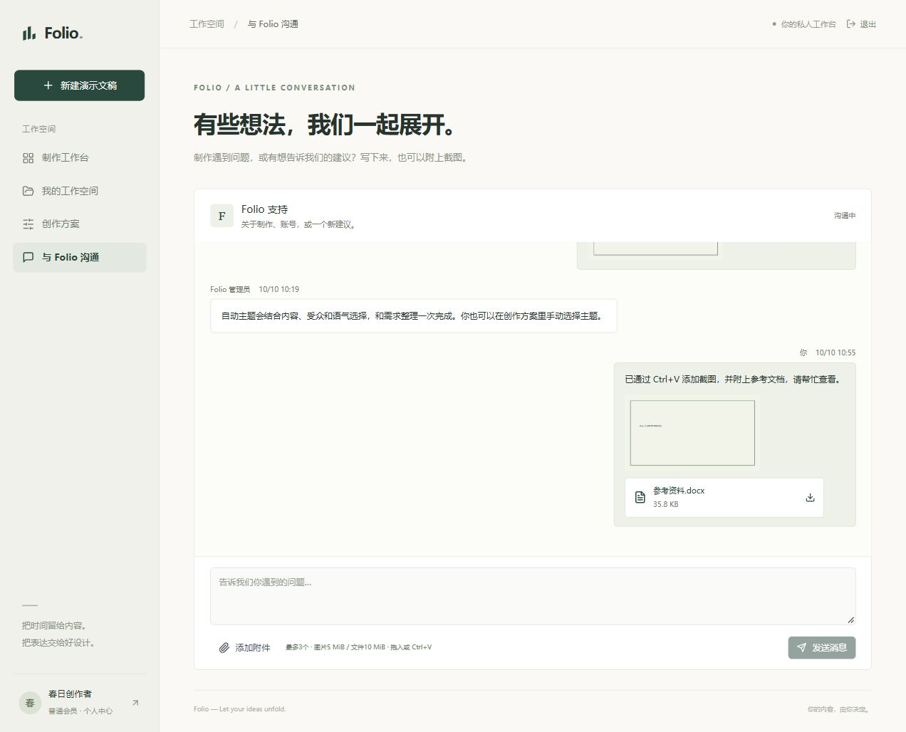

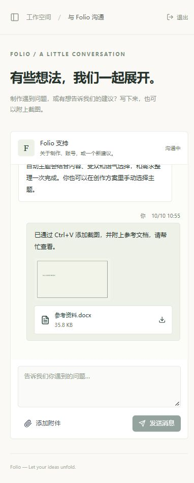

## 公告

管理员从侧边栏「公告管理」创建和预览草稿，再发布或撤回，可设置展示时长。普通用户登录后自动看到有效公告；勾选「当日不再展示」后，同账号当天再次登录、刷新或更换设备都不再展示，次日恢复（北京时间）。没有发布的公告不会出现占位消息。

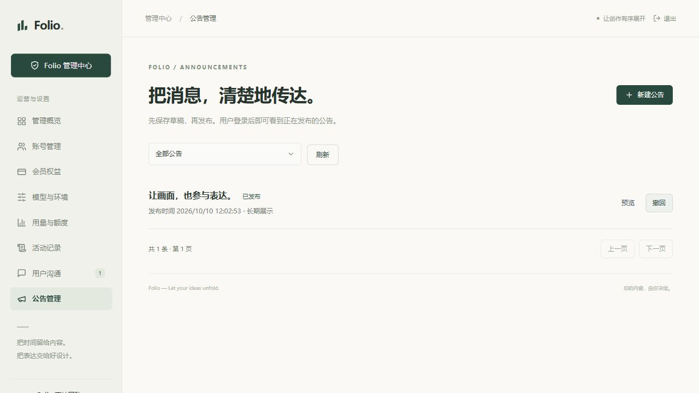

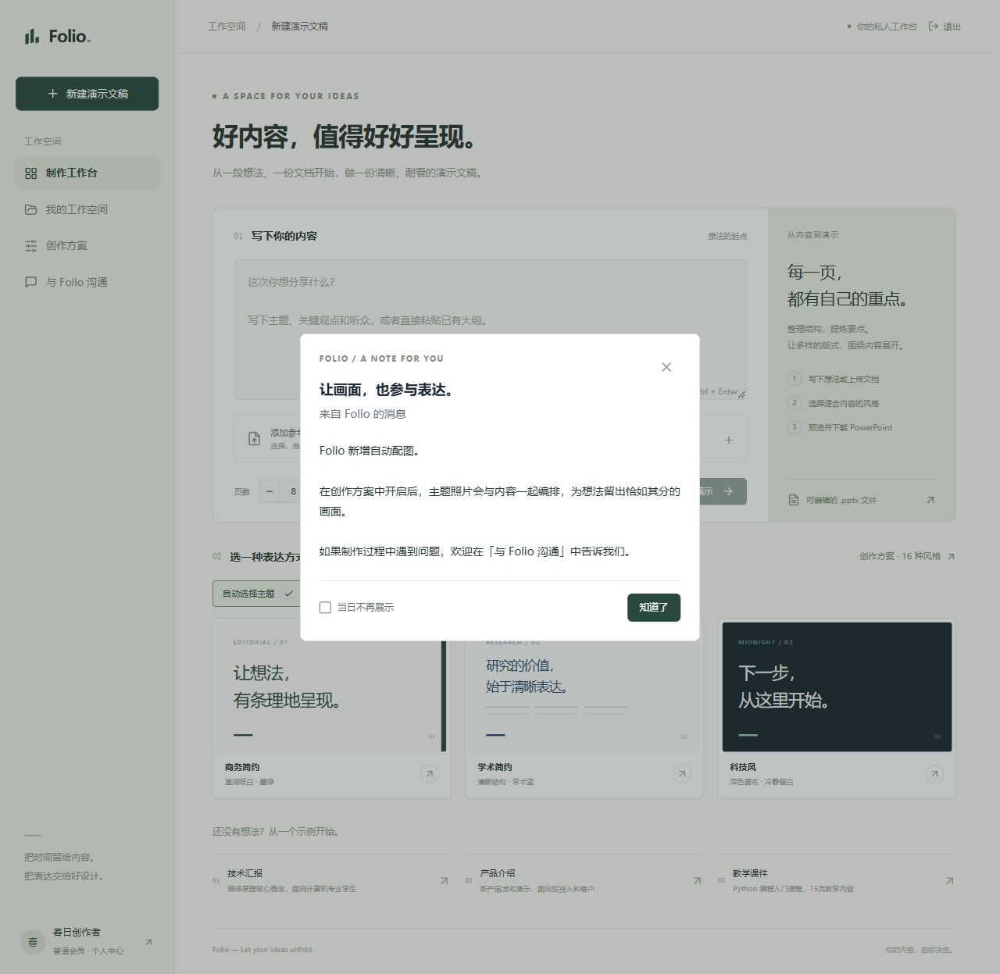

<details>
<summary>查看手机公告页面</summary>

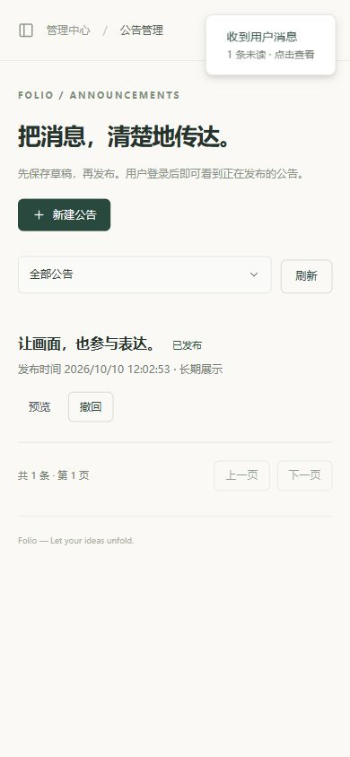

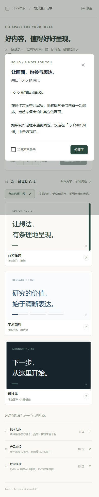

</details>

## 导航与轻量图片

手机顶部显示 Folio Logo、当前页面和紧凑导航，直接切换作品/方案/沟通/个人中心，滚动时保留导航入口；桌面与手机共享墨绿/浅绿按钮。浏览器标签标题统一为英文。参考图和沟通图上传前自动压缩，消息用轻量缩略图展示，点击查看大图；文档附件保持原样。

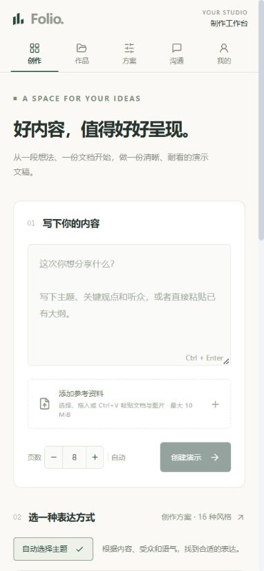

<details>
<summary>查看手机导航与桌面按钮</summary>

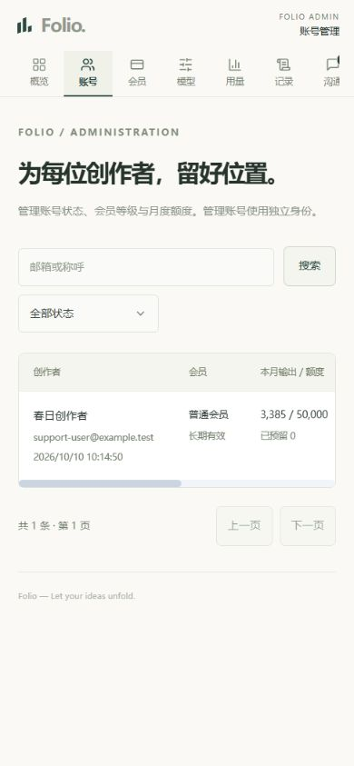

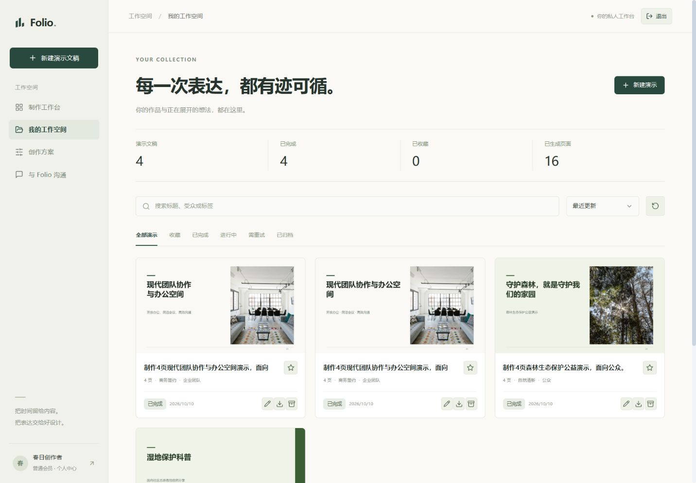

</details>
