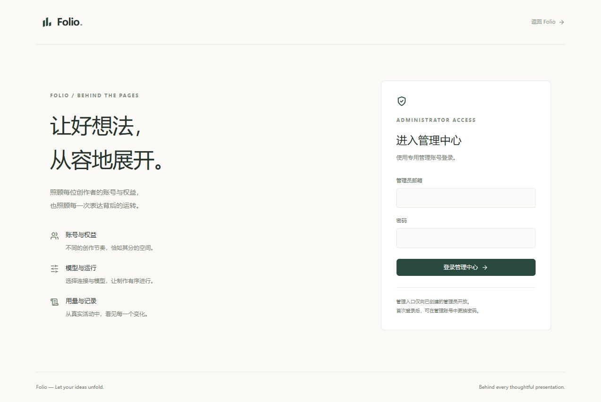

# Folio 运行记录

日期：2026-10-09（北京时间）。本文件记录实际部署，不含登录密码、API Key 或证书私钥。

- 应用：https://lightsmile.ink
- 专用管理员入口：https://lightsmile.ink/#/admin/login
- 初始管理员邮箱：`admin@lightsmile.ink`，独立新身份，初始密码按用户提供值设置；可在“管理账号”修改。
- 主机：Ubuntu 22.04，Python 3.10.12，Nginx 1.18.0。
- 发布：`folio-0.1.0-r8-deploy`，应用 wheel 与 Vite 静态资源；服务器不运行源码或 Vite。
- 运行：systemd `folio.service`，用户 `folio`，单 worker，监听 `127.0.0.1:8000`。Nginx 提供公网 80 / 443，HTTP 跳转 HTTPS。服务已设置开机启动与异常自动重启。
- 模型：迁移现有 DeepSeek 连接，默认 `deepseek-flash`；真实密钥仅保存于受限配置文件，管理页面不返回原值。

## 路径与维护

| 路径 | 用途 |
|---|---|
| `/opt/folio/current` | 当前发布软链接 |
| `/opt/folio/releases/folio-0.1.0-r8-deploy` | 当前静态资源、wheel、独立 `.venv` |
| `/etc/folio/runtime/folio.env` | 运行配置，folio 所有，0600 |
| `/etc/folio/tls` | Nginx 证书和私钥，私钥 0600 |
| `/var/lib/folio/folio.sqlite3` | 正式用户、会话、会员、用量与项目 |
| `/var/lib/folio/storage` | 正式上传、预览与 PPTX |
| `/var/backups/folio/20261009-r8` | 本次切换前的数据和配置备份，root 专用 |
| `/opt/folio/releases/folio-0.1.0-r7-deploy` | 保留的上一发布，可按 DEPLOY.md 回滚 |

常用命令（SSH 登录服务器后）：

```bash
systemctl status folio nginx --no-pager
journalctl -u folio -n 100 --no-pager
curl --fail https://lightsmile.ink/health
nginx -t
readlink -f /opt/folio/current
# 维护前先等待当前制作结束并按 DEPLOY.md 备份
systemctl restart folio
```

允许的模型参数可在管理页修改并立即应用；部署路径、HTTPS 与来源设置离线编辑后重启。升级、回滚、完整备份和证书替换步骤见 [DEPLOY.md](../DEPLOY.md)。证书有效到 **2027-01-04 23:59:59 UTC**（北京时间 2027-01-05 07:59:59），项目不自动续签。

## 验收

公网 HTTP 301、HTTPS 可信链 / 域名校验、静态首页、指定管理员登录及独立 Cookie、所有管理查询、密钥脱敏、DeepSeek 余额与模型目录查询已通过。正式服务与 Nginx 均 active；8000 只绑定本机。

真实模型生成使用同一安装版本和 Nginx 代理规则，但配置、数据库与产物放在 `/var/lib/folio-qa-20261009`，不添加正式测试账号，不修改正式用户密码。四页演示耗时 **9.82 秒**，**5 次调用、2644 输入 / 669 输出 Tokens、896 缓存输入 Tokens**。验证了 HTTPS / WebSocket、参考文档上传 / 去重、断线后继续、重连恢复下载、PNG / 可编辑 PPTX、不同账号隔离，以及重启后会话、项目和用量保留；重复继续没有新增调用。已查看四张真实预览，未见明显裁切或重叠；没有以几何检查分数代表审美质量。

验收临时端口仅监听回环地址，完成后已停止服务并移除临时 Nginx 配置和密钥副本。正式浏览器检查 1440px 桌面和 390px 手机管理页、导航及公开入口。首次手机检查发现活动表格列被挤窄，r8 为表格设置最小宽度，让其在自身容器中横向滚动。

管理初始密码兼容回归：后端管理与账号隔离 **23 项**、前端管理登录 **2 项**通过，生产构建通过。详细报告为本地忽略目录 `storage/deploy-qa/production-report.json`、`qa-live-report.json`；其中不含密码或密钥。


